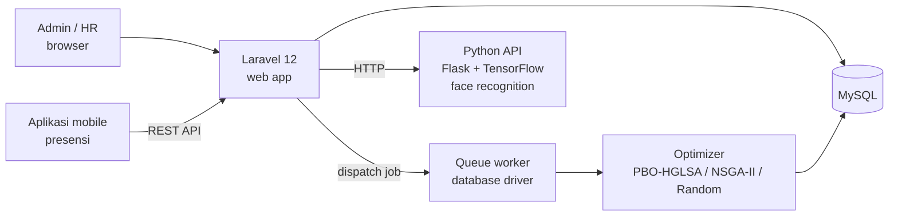
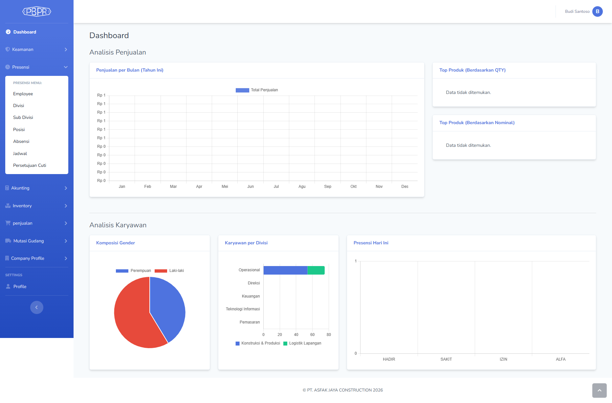
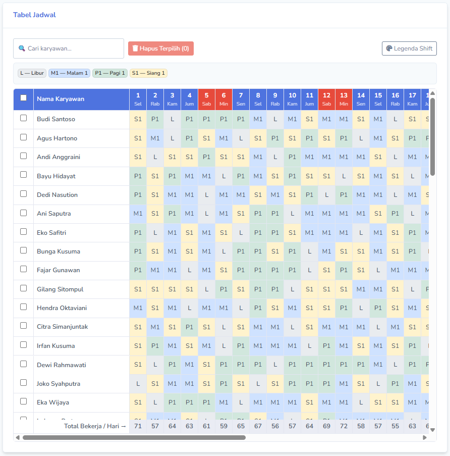
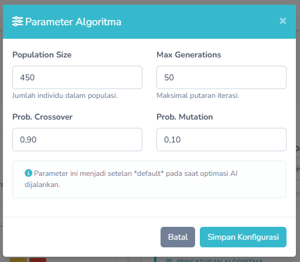
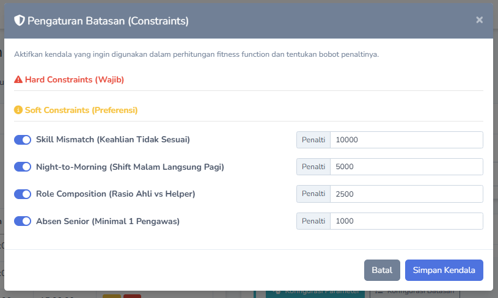
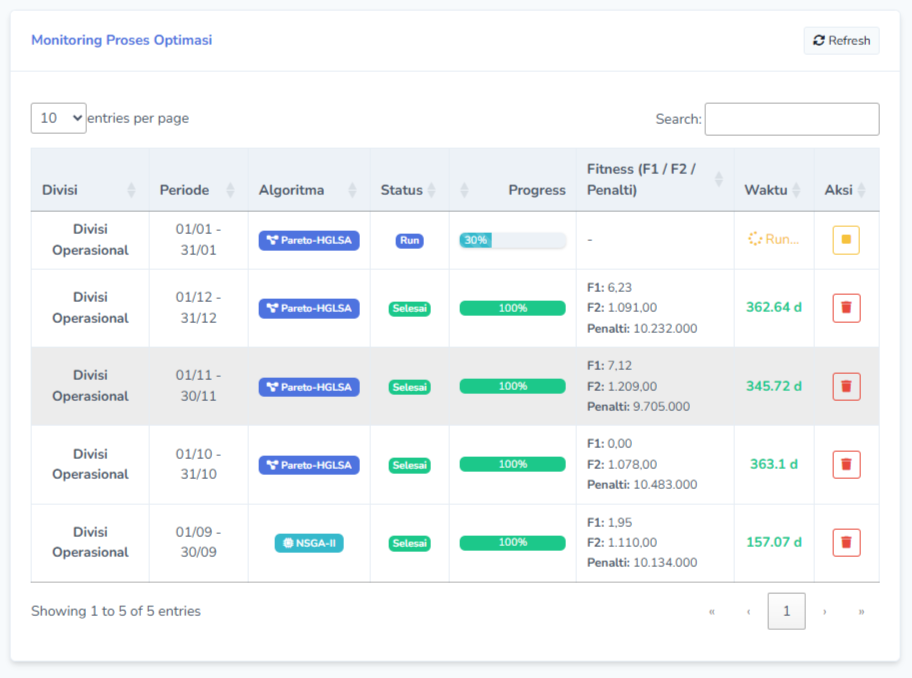
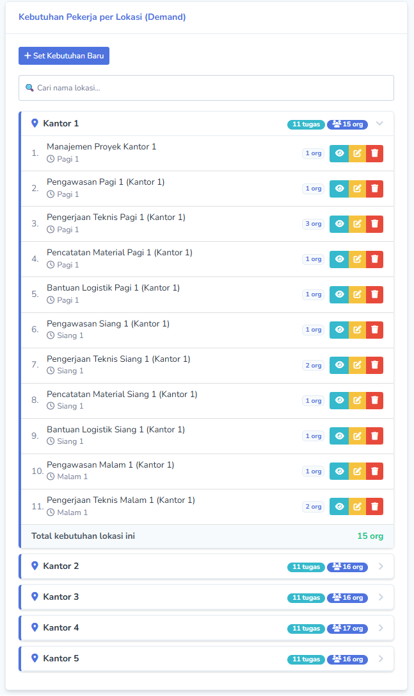
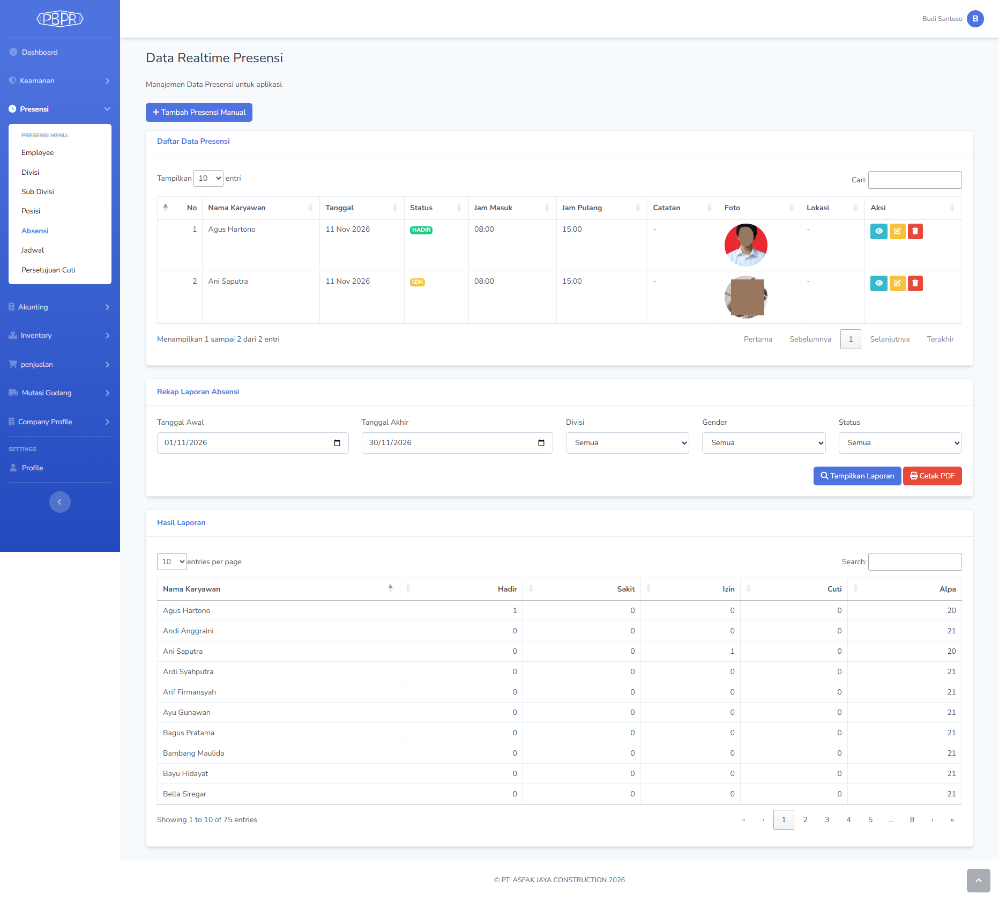
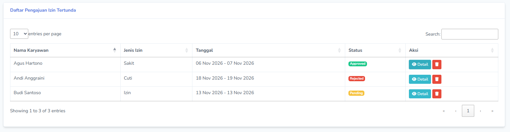
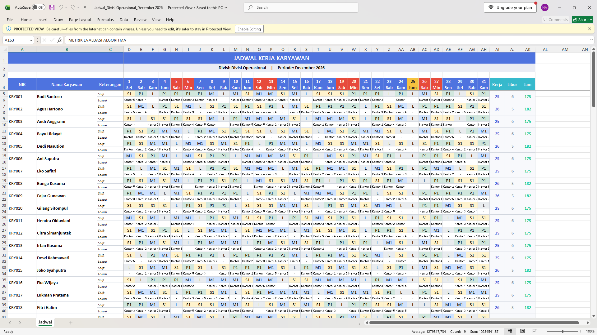

# Sistem Penjadwalan Shift & Presensi Karyawan

Aplikasi web untuk menyusun jadwal shift karyawan proyek konstruksi secara otomatis dengan **optimasi multi-objektif**, lengkap dengan presensi berbasis lokasi dan face recognition.

Sistem ini terdiri dari dua bagian utama dengan konteks pengerjaan yang berbeda:
- **Sistem presensi**: dikembangkan sebagai tugas saat magang di PT. Asfak Jaya Construction.
- **Sistem penjadwalan berbasis algoritma optimasi**: dikembangkan sebagai Tugas Akhir (Skripsi) Teknik Informatika, Universitas Mercu Buana.

Keduanya dibangun dengan Laravel 12. Rincian pembagiannya ada di [Peran Saya](#peran-saya).

> **Catatan akses:** repositori publik ini hanya berisi dokumentasi. Kode sumber lengkap tidak dipublikasikan dan tersedia untuk pemegang lisensi. Lihat [Akses & Lisensi](#akses--lisensi).

---

## Daftar Isi

- [Fitur Utama](#fitur-utama)
- [Algoritma Optimasi](#algoritma-optimasi)
- [Arsitektur](#arsitektur)
- [Teknologi](#teknologi)
- [Screenshot](#screenshot)
- [Peran Saya](#peran-saya)
- [Instalasi (Pemegang Lisensi)](#instalasi-pemegang-lisensi)
- [Akses & Lisensi](#akses--lisensi)

---

## Fitur Utama

**Penjadwalan otomatis**
- Generate jadwal shift satu periode per divisi dengan tiga metode: **PBO-HGLSA** (metode usulan), **NSGA-II** (pembanding), dan **Random** (baseline).
- Proses optimasi berjalan di background (queue), dengan monitoring progress, nilai fitness (F1, F2, penalti), waktu eksekusi, serta tombol batalkan dan hapus riwayat.
- Parameter algoritma (ukuran populasi, jumlah generasi, peluang crossover dan mutasi) serta bobot penalti tiap batasan dapat diatur dari halaman konfigurasi.

**Manajemen jadwal**
- Matriks jadwal dengan kolom nama yang tetap terlihat saat digulir, warna per shift, penanda akhir pekan dan libur nasional, kolom ringkasan, serta total staf per hari.
- Edit per sel dan hapus massal.
- Export jadwal ke Excel (XLSX) dengan header berwarna, legenda shift, freeze panes, dan ringkasan metrik algoritma.

**Data master**
- Shift, libur nasional, lokasi kantor dengan koordinat GPS, serta kebutuhan pekerja per lokasi, shift, divisi, dan posisi (*demand*).

**Presensi**
- API presensi untuk aplikasi mobile dengan validasi lokasi GPS (maksimal 100 m dari kantor, dihitung dengan rumus Haversine).
- Face recognition melalui layanan Python (Flask + TensorFlow).
- Pengajuan dan persetujuan izin, sakit, dan cuti, serta rekap presensi.

**Dashboard**
- Grafik komposisi karyawan per gender dan divisi, serta presensi hari ini.

---

## Algoritma Optimasi

Penjadwalan dimodelkan sebagai masalah **optimasi multi-objektif dengan batasan**.

**Fungsi objektif (diminimalkan)**

| Simbol | Objektif | Rumus |
| --- | --- | --- |
| F1 | Keadilan beban kerja | Standar deviasi jam kerja antar karyawan |
| F2 | Kekurangan tenaga kerja | Σ \| kebutuhan − jumlah yang ditugaskan \| per hari, lokasi, dan shift |

**Batasan (dihitung sebagai penalti berbobot)**

| Kode | Batasan |
| --- | --- |
| C1 | Karyawan hanya ditugaskan ke posisi yang diminta dan tidak melebihi kuota posisi |
| C2 | Anti-fatigue: shift malam tidak boleh langsung diikuti shift pagi |
| C3 | Komposisi peran: helper tidak boleh lebih dominan daripada tenaga ahli |
| C4 | Setiap regu shift wajib memiliki minimal satu pengawas atau senior |

**PBO-HGLSA** adalah algoritma genetika hibrida berbasis Pareto:
1. Inisialisasi populasi kromosom (matriks karyawan × hari).
2. Evaluasi F1, F2, dan penalti.
3. *Fast non-dominated sorting* dengan *Constrained Domination Principle* (Deb dkk., 2002) dan *crowding distance*.
4. Tournament selection, crossover, dan mutasi.
5. **Local Search Repair** dengan lima aturan deterministik: libur nasional, anti-fatigue, maksimal 6 hari kerja beruntun, Minggu libur, dan kompensasi hari libur.
6. Environmental selection, diulang sampai jumlah generasi terpenuhi.

NSGA-II dipakai sebagai pembanding dengan fungsi objektif dan batasan yang sama, tetapi tanpa Local Search Repair. Kedua implementasi memakai optimasi tingkat kode yang identik (caching dan pre-computation), sehingga perbandingan waktu eksekusinya adil.

---

## Arsitektur



---

## Teknologi

| Lapisan | Teknologi |
| --- | --- |
| Backend | PHP 8.2, Laravel 12, queue (database driver) |
| Database | MySQL / MariaDB |
| Frontend | Blade, Bootstrap (SB Admin 2), jQuery, DataTables, Chart.js, SweetAlert2 |
| Laporan | PhpSpreadsheet (XLSX), DomPDF |
| Hak akses | spatie/laravel-permission |
| Face recognition | Python, Flask, TensorFlow/Keras, scikit-learn |

---

## Screenshot

| Dashboard | Matriks jadwal |
| --- | --- |
|  |  |

| Parameter algoritma | Pengaturan batasan |
| --- | --- |
|  |  |

| Monitoring optimasi | Kebutuhan per lokasi |
| --- | --- |
|  |  |

| Presensi & rekap | Izin dan cuti |
| --- | --- |
|  |  |

**Export Excel**



Semua data yang terlihat di screenshot adalah data contoh (fiktif).

---

## Peran Saya

| Bagian | Konteks pengerjaan | Dikembangkan oleh |
| --- | --- | --- |
| **Sistem penjadwalan berbasis algoritma**: PBO-HGLSA, NSGA-II, baseline Random, job queue dan monitoring optimasi, kebutuhan pekerja per lokasi, konfigurasi parameter dan batasan, matriks jadwal, export Excel | Tugas Akhir (Skripsi) | Saya |
| **Sistem presensi**: API presensi dengan validasi GPS, face recognition, pengajuan dan persetujuan izin/cuti, rekap presensi | Tugas magang | Saya |
| **Modul sistem informasi lainnya**: akuntansi, inventory, penjualan, mutasi gudang, retur, company profile, hak akses | Project magang | Tim magang |

Migration dan seeder data contoh untuk sistem penjadwalan dan presensi juga saya buat.

---

## Instalasi (Pemegang Lisensi)

Kebutuhan: PHP 8.2+ (ekstensi `gd`, `zip`, `fileinfo`, `mbstring`, `pdo_mysql`), Composer 2, MySQL. Python 3 hanya diperlukan untuk face recognition.

```bash
cp .env.example .env            # Windows: copy .env.example .env
composer install
php artisan key:generate
php artisan migrate --seed      # membuat database penjadwalan_karyawan beserta data contoh
php artisan storage:link
php artisan serve               # http://127.0.0.1:8000
php artisan queue:work --memory=512   # jalankan di terminal terpisah, wajib untuk optimasi
```

Akun demo hasil seeder: username `Budi Santoso`, password `password`. **Ganti password ini sebelum dipakai di server produksi.**

Face recognition (opsional): letakkan file model `final_hybrid_model.h5` di folder `python_api/` (file model tidak disertakan di repositori), lalu jalankan:

```bash
cd python_api
pip install flask tensorflow joblib numpy scikit-learn
python app.py                   # http://127.0.0.1:5000
```

---

## Akses & Lisensi

Hak cipta dilindungi. Lihat file [LICENSE](LICENSE).

Kode sumber lengkap, file model, dan lisensi penggunaan hanya tersedia melalui perjanjian tertulis. Untuk demo, akses kode, atau pembelian lisensi, hubungi:

- GitHub: [@ANugroho186](https://github.com/ANugroho186)
- Email: nugroho.a.wibisono@gmail.com
